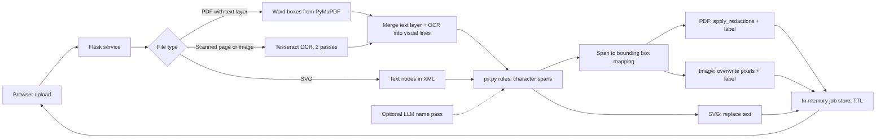

# pii-anonymizer

Self-hosted web service that redacts personal data in PDFs, scans, images and SVGs before they
are shared with third parties or sent to an LLM. Detection rules target German business
documents (claims, expert reports, invoices, forms). Everything runs locally, including OCR.

## Why

Sending real documents to an LLM or an external partner usually means stripping names,
addresses, bank details and IDs first. Doing that by hand is slow and error-prone, and the
common shortcut of drawing black boxes over a PDF leaves the text selectable underneath.
This service removes the text itself, keeps the parts that matter for analysis (amounts,
dates, postcode and city, technical content) and replaces PII with stable placeholders so the
document still reads coherently.

## How it works



1. `pii.py` finds PII in plain text and returns character spans plus a replacement. It is pure
   Python with no IO, so the same rules serve PDFs, OCR output and SVG.
2. `redact.py` maps spans to word boxes. Text PDFs are redacted with PyMuPDF
   `add_redact_annot` + `apply_redactions`, which removes the glyphs from the content stream.
   Text pages are also OCR'd (`deep=True`) to catch names in embedded photos. Scanned pages
   are rasterized, OCR'd and overwritten at pixel level.
3. Filled-in forms are a special case: the label ("Geb.-Datum") is often only in the scanned
   background while the value is in the text layer. `merge_sources()` merges both sources into
   visual lines by vertical position, so label-based rules can still fire.
4. Metadata (PDF info, XMP, EXIF, SVG `<title>/<desc>/<metadata>`) is always stripped.

## What gets redacted

| Data | Handling |
|---|---|
| Person names | Consistent placeholder `[PERSON 1]`; the same name gets the same label across the whole batch |
| Street + house number | Replaced with `[ADDRESS n]`; postcode and city are kept for regional analysis |
| Licence plate | `B-XY 1234E` -> `B-XX ####E` (city code and E/H suffix optional) |
| VIN | Last 4 characters kept (optional) |
| Email, phone, IBAN, BIC, tax number, case/policy numbers | Placeholders |
| Date of birth | Placeholder, detected only via the field label, never by date format |
| Amounts, other dates, mileage, company names | Left unchanged |

Person detection combines salutations and titles (`Herr`, `Frau`, `Dr.`, `Dipl.-Ing.`), field
labels (`Halter:`, `Auftraggeber:`, `Versicherungsnehmer:`), and a first-name list for
free-standing names, filtered by a stopword list to avoid false positives on brands, cities
and technical terms. An optional LLM pass can add names the rules miss.

## Features

- Multi-file batch upload, ZIP download, per-batch consistent placeholders
- Real text removal in PDFs, verified by tests (`get_text()` no longer finds the originals)
- Local OCR (Tesseract, `deu+eng`) with upscaling, contrast preprocessing and a second raw pass
- Per-tenant access links (`/c/<token>`) with PBKDF2 password hashes, HMAC-signed session
  cookies and a brute-force brake
- Originals never touch disk; results live in RAM for `ANON_RESULT_TTL` seconds
- Metadata-only event log (no file names, no contents)
- Optional LLM assist through any OpenAI-compatible endpoint, off by default and opt-in per upload

## Stack

Python 3.12, Flask, Gunicorn, PyMuPDF, Pillow, Tesseract (via pytesseract), plain JavaScript frontend.

## Run

### Docker

```bash
cp .env.example .env          # set ANON_ADMIN_PASS; ANON_COOKIE_SECURE=0 for plain HTTP
docker compose up -d --build
docker compose exec anonymizer python manage.py add-client "Demo Office" --pw "demo-pass"
# open the printed http://localhost:8000/c/<token> link
```

Admin UI: `http://localhost:8000/admin?k=<ANON_ADMIN_PASS>`.

### Local

Requires the `tesseract` binary with German language data (`brew install tesseract tesseract-lang`
or `apt install tesseract-ocr tesseract-ocr-deu`).

```bash
python -m venv .venv && . .venv/bin/activate
pip install -r requirements.txt -r requirements-dev.txt
export DATA_DIR=./data ANON_COOKIE_SECURE=0 ANON_ADMIN_PASS=change-me
python manage.py add-client "Demo Office" --pw "demo-pass"
python anonymizer_service.py   # http://127.0.0.1:8000
pytest -q
```

Run with a single Gunicorn worker (as in the Dockerfile): jobs are held in process memory, so
multiple workers would route downloads to the wrong process.

## Configuration

| Variable | Default | Purpose |
|---|---|---|
| `DATA_DIR` | `/data` | Holds `secret`, `clients.json`, `events.jsonl`, `access.log` |
| `ANON_ADMIN_PASS` | empty | Admin UI password; empty disables `/admin` |
| `ANON_MONITOR_KEY` | empty | Key for `/api/monitor/activity`; empty disables it |
| `ANON_MAX_MB` | `80` | Max upload size per request |
| `ANON_RESULT_TTL` | `1800` | Seconds results stay downloadable |
| `ANON_SESSION_TTL` | `43200` | Session cookie lifetime in seconds |
| `ANON_COOKIE_SECURE` | `1` | Set `0` for local HTTP |
| `ANON_TRUST_PROXY` | `0` | Trust `X-Forwarded-For` for client IP (only behind a proxy) |
| `ANON_BRAND` | `PII Anonymizer` | Name shown in the UI |
| `ANON_PUBLIC_URL` | `http://localhost:8000` | Base URL printed by `manage.py` |
| `ANON_OCR_LANG` | `deu+eng` | Tesseract languages |
| `ANON_OCR_MIN_CONF` | `35` | Minimum OCR word confidence |
| `ANON_SCAN_DPI` | `200` | Rasterization DPI for scanned PDF pages |
| `ANON_OCR_MIN_WIDTH` | `1700` | Images narrower than this are upscaled before OCR |
| `ANON_LLM_BASE_URL` | Gemini OpenAI-compatible URL | Any OpenAI-compatible `/chat/completions` base |
| `ANON_LLM_API_KEY` | empty | Enables the optional LLM pass |
| `ANON_LLM_MODEL` | `gemini-2.5-flash-lite` | Model for the LLM pass |

## Project layout

| File | Content |
|---|---|
| `pii.py` | Detection rules and masking, pure functions |
| `redact.py` | PDF / raster / SVG engines, span-to-box mapping, OCR |
| `anonymizer_service.py` | Flask app: auth, upload, in-memory job store, admin, monitor endpoint |
| `manage.py` | CLI to create and list tenants |
| `index.html` | Frontend (drag and drop, options, result report) |
| `tests/` | Rule tests, end-to-end PDF/SVG tests, service smoke tests (fictitious data) |

## Limitations

- Handwriting is barely recognized by Tesseract; handwritten names on forms stay visible.
  The UI asks users to review results before sharing.
- Rules are tuned for German documents. Unusual names without a salutation or label can slip
  through; the LLM pass helps but sends text to the provider.
- Company names are intentionally kept (insurers, workshops, brands).
- Rasterized scan pages lose their original text layer and grow in size.
- The admin password is passed as a query parameter; put the service behind HTTPS and do not
  expose `/admin` publicly. Login throttling and the job store are in-process and reset on restart.
- Single-process design: horizontal scaling would need a shared job store.

## License

MIT
